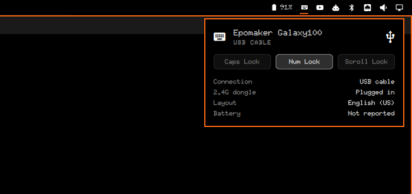

# Keyboard Status — an Omarchy shell plugin

A bar widget that shows how your keyboard is connected and which lock keys
are on. It follows the active Omarchy theme and pairs with a mouse battery
widget on the right of the bar.



- Keyboard glyph in the bar, dimmed when no keyboard is connected
- A **CAPS** tag and the theme's urgent colour while Caps Lock is on
- Click for a panel with the keyboard's name, its connection (USB cable,
  2.4G dongle or Bluetooth), Caps / Num / Scroll Lock, whether the dongle
  is plugged in, and the active layout

## Install

```
omarchy plugin add https://github.com/hell0world69/omarchy-keyboard-status --enable
```

Update with `omarchy plugin update`, remove with
`omarchy plugin remove hell0world.keyboard-status`.

## Settings

| Key | Default | What it does |
|-----|---------|--------------|
| `match` | `""` | Substring of the keyboard's input name, e.g. `"galaxy100"`. Empty auto-detects USB/Bluetooth devices with a Caps Lock LED that are not mice. |
| `showCaps` | `true` | Show the CAPS tag in the bar. |
| `hideWhenAbsent` | `false` | Hide the widget when no keyboard matches. |

List your input devices with `cat /proc/bus/input/devices`.

## How it works

`watch.sh` reads sysfs with bash builtins every 0.4s and prints a line only
when something changes: lock-key LEDs from `/sys/class/leds`, and the
connection from each matching input device's name and bus type. A name
containing "dongle", "2.4G" or "receiver" counts as a dongle; bus `0005` is
Bluetooth; anything else on USB is the cable. The layout comes from
`hyprctl devices` when the panel opens.

## Battery

Not shown. Most 2.4G boards, including the Epomaker Galaxy100 this was built
on, never report a battery level to the computer: not to the kernel, UPower,
or VIA. The panel tells you to press Fn + B, which shows the level on the
keyboard's number row.

## License

MIT
